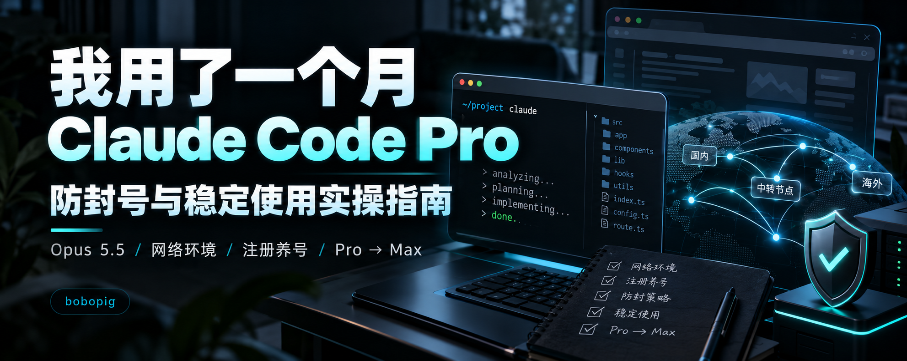

# Claude Code Survival Guide

**Chinese-first, hands-on documentation by bobopig.** I have used Claude Code Pro for a month. This repository combines my real workflow, reusable troubleshooting commands, and links to community-maintained tools.

[中文 README](README.md) · [Quick Start (Chinese)](docs/00-start-here.md) · [Tools](tools/README.md) · [Credits](references/CREDITS.md) · [Changelog](CHANGELOG.md) · [Publish](PUBLISHING.md)



## What's included?

- [Agent comparison](docs/01-agents.md): Claude Code, Cursor, OpenCode and Grok Bot.
- [Network troubleshooting](docs/02-network.md): DNS, IPv4/IPv6, WebRTC, Mihomo and AgentRoute.
- [Local environment audit](docs/03-local-audit.md): Windows/macOS checks, credentials, and stale environment variables.
- [Account and subscriptions](docs/04-account-subscription.md): sign-in, billing, Pro/Max, verification and personal usage habits.
- [Troubleshooting](docs/05-troubleshooting.md): authentication failures, proxy mismatches, payment issues.
- [Privacy](docs/06-privacy.md): telemetry options and relevant technical research.
- [Tools and references](tools/README.md): original upstream projects and maintainers.

Most detailed chapters are currently **in Chinese**. Contributions translating them are welcome.

## Run a read-only local audit

```bash
python scripts/check_env.py
```

Python 3.9+; no third-party dependencies. It does not delete files or print credential values. Public-network lookup is **opt-in** with `--network`, and only describes the Python process's path — not necessarily your browser or Claude Code.

## Important distinction

This repository is **not affiliated with Anthropic**. No tool here guarantees that an account cannot be suspended. Personal practices, community anecdotes and documented settings are treated separately. Respect service availability, identity verification and the provider's terms. No proxies or accounts are distributed here.

Original written content: [CC BY 4.0](LICENSE-CONTENT.md). Original repository scripts: [MIT](LICENSE-CODE). Linked third-party works retain their respective licenses.

**Maintainer: bobopig · v1.0.0 · 2026-11-01**
